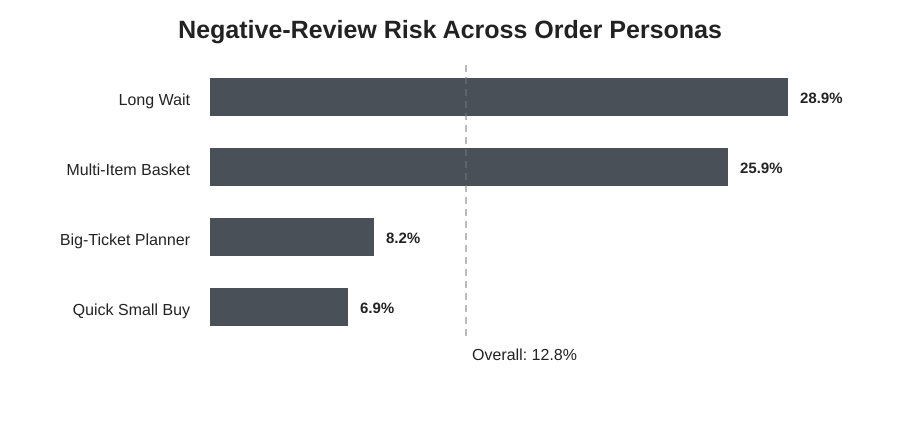

# 🛒 Olist customer reviews: which orders should a service team follow up?

Suppose the team can follow up on one in ten orders. I compared two ways to choose that queue on the same 19,165 held-out orders. With **1,917 slots**, the model used at purchase picked up **567** orders that received a one- or two-star review. At delivery, the model picked up **1,071**. Waiting improved targeting, although it also gave the team less time to resolve a problem in transit. [Compare both queues](outputs/predictions/score_deciles.csv)

The study covers 95,824 delivered Brazilian e-commerce orders with observed reviews. Of these, 12,272 (12.8%) received one or two stars. The data capture who left a negative review. Measuring whether outreach changes that outcome would require a service pilot.

**Explore the analysis** · [Executed Python walkthrough](notebooks/olist_negative_review_end_to_end.ipynb) · [DuckDB order joins](sql/01_build_master_orders.sql) · [Model validation report](docs/model_validation_report.md)

## From transactions to one row per order

Items, payments and reviews can each have several rows per order. I aggregated items and payments separately and selected the latest review before joining the tables. This prevents a multi-item order from counting several times. A basket with three items and two payment records could otherwise produce six joined rows for a single review. I also separated the inputs by decision time. Basket contents, payment and location are available at purchase. Actual transit time and lateness enter only at delivery. [Data preparation notebook](notebooks/01_data_join_and_clean.ipynb)

Both models use the same stratified holdout of 19,165 orders. Preprocessing is fitted on training data, and a separate validation subset determines model settings and classification thresholds. The comparison measures the two workflows as implemented. Both the algorithm and the available features differ between stages.

## How the two models perform

| Decision point | Model | Precision | Recall | F1 | ROC-AUC | PR-AUC |
|---|---|---:|---:|---:|---:|---:|
| At placement | LightGBM | 0.219 | **0.473** | 0.299 | 0.658 | 0.233 |
| At delivery | CatBoost | **0.565** | 0.431 | **0.489** | **0.775** | **0.496** |

At the selected thresholds, the placement model catches more negative reviews but generates more false alarms. Once an order is delivered, the CatBoost score gives the service team a more selective queue. [Test metrics](outputs/model_metrics/placement_vs_delivery.csv)


## What doubling follow-up capacity would buy

| Share of test orders followed up, highest delivery score first | Share of all negative reviews captured |
|---|---:|
| 5% | 29.8% |
| 10% | 43.6% |
| 20% | 57.9% |

The first 1,917 slots in the delivery queue contain 1,071 negative reviews. The next 1,916 slots add 351. That second group has an 18.3% negative-review rate, compared with 55.9% in the first. A manager considering a larger queue should evaluate the cost and likely benefit of contacting that second group. [Capacity analysis](outputs/model_metrics/capacity_curve.csv)

## Which complaints would a late-delivery rule miss?

Across the full cohort, the Long Wait group averaged 25.3 days to delivery. Some 39.5% of those orders were late and 29.1% received a negative review. Multi-Item Basket orders had a nearly comparable negative-review rate of 25.9%, yet only **3.2%** arrived late. A rule that flags late deliveries would overlook many dissatisfied customers in that second group. It would be worth reviewing multi-item complaints for missing items, split shipments or other fulfilment problems. The review label alone cannot distinguish among those explanations. [Cluster sizes, lateness and review outcomes](outputs/interpretation/cluster_profile.csv)

I used K-Means to describe these patterns after the order lifecycle was complete. A second method, DBSCAN, assigned 3.6% of orders to noise and agreed weakly with the K-Means labels (adjusted Rand index 0.159). I would use the profiles to generate hypotheses for service audits. Assigning incoming orders to those groups for early outreach would require a separate design because the clustering inputs include delivery outcomes. [Clustering notebook](notebooks/02_clustering.ipynb) · [Robustness results](outputs/interpretation/dbscan_robustness.csv)



## How much confidence to place in the ranking

The delivery score’s negative-review rate falls from 55.9% in the highest-risk decile to 3.8% in the lowest. A random holdout leaves performance on later orders and probability calibration untested. The delivery model’s decile-level KS was 0.435, compared with 0.233 at placement. Late days and time relative to the promised date ranked highly in the delivery model, alongside item count. Those diagnostics help explain which cases to inspect. Quantifying the incremental value of shipping data would require the same algorithm and shared feature set at both stages, followed by a comparison with delivery features added. [Validation report](docs/model_validation_report.md) · [Order profiles](outputs/interpretation/cluster_profile.csv)

A separate comparison uses each model’s validation-selected threshold and lets queue size vary. Early screening misses 102 fewer negative reviews but adds 3,332 false alarms. Its estimated error cost is lower only if one miss costs more than 32.7 false alarms. Olist’s actual costs are unknown. [Cost calculation](outputs/model_metrics/cost_breakeven.csv)

## Designing a service pilot

The historical rankings support testing a limited follow-up queue. Before scheduling agents, I would replay the policy on later order months and use timestamps to exclude customers who had already reviewed their order before an agent could contact them. The study includes only reviewed orders; a live queue also contains customers who would never submit a review.

Within eligible high-risk orders, randomly assign the proposed contact or usual service. Track resolution within a fixed window, time spent per case and subsequent review participation alongside negative ratings. Outreach can change who writes a review, which makes the percentage of negative ratings among reviewers alone an ambiguous success measure. The business case depends on additional issues resolved per agent-hour. The retrospective capture figures give a starting queue size for that experiment.

## SQL pipeline (DuckDB)

| Step | Purpose |
|---|---|
| [Build the order table](sql/01_build_master_orders.sql) | Aggregate eight source tables to order level and derive features. |
| [Check data quality](sql/02_quality_checks.sql) | Verify unique orders, review labels, timestamps and reconciliation to source totals. |
| [Explore review risk](sql/03_risk_analysis.sql) | Compare review rates by delivery timing, geography, category, seller and month. |
| [Calculate scorecard metrics](sql/04_scorecard_metrics.sql) | Use committed model outputs to calculate Gini, decile KS, capture and lift. |

## Reproduce the analysis

The Python notebooks create the cohort and split, fit the placement and delivery models, and evaluate risk scores. The DuckDB scripts reproduce order preparation and calculate descriptive and scorecard results. The [executed walkthrough](notebooks/olist_negative_review_end_to_end.ipynb) summarizes the committed results. For a full rebuild, follow the [data instructions](data/README.md) and run notebooks 01–06 in order. Notebook 06 prepares the [planned Power BI report](powerbi/README.md).

```bash
pip install -r requirements.txt
python scripts/run_sql_pipeline.py --steps 04
python scripts/validation_metrics.py
pytest tests/ -q
```

These commands use committed outputs or synthetic test data. With the eight raw CSVs in place, run `python scripts/run_sql_pipeline.py --check-known-totals` for all four SQL steps.
