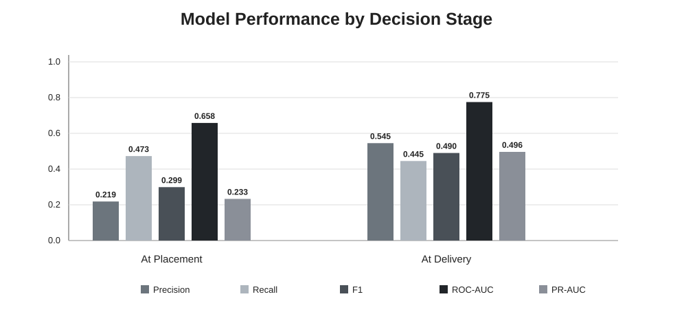

# Predicting Negative Customer Reviews in Brazilian E-Commerce

If a service team has 1,917 follow-up slots, which orders should it choose? On the same held-out sample, the placement ranking identified **567 orders** that received a one- or two-star review. The delivery ranking identified **1,071** with the same capacity. Earlier contact still has a potential advantage: a team may be able to resolve a shipping problem while an order is in transit. The data record review outcomes, so they let me evaluate targeting accuracy but cannot establish the value of contacting a customer early. [Held-out deciles](outputs/predictions/score_deciles.csv)

The study covers 95,824 delivered Olist orders with observed reviews. Of these, 12,272 (12.8%) received one or two stars. Cancelled orders and customers who never reviewed a purchase fall outside this sample.

## From transactions to one row per order

Items, payments and reviews can each have several rows per order. I aggregated items and payments separately and selected the latest review before joining the tables. This prevents a multi-item order from counting several times. The placement model uses purchase, basket, payment and geographic information. The delivery model can also use transit time and deviation from the promised date.

Both models use the same stratified holdout of 19,165 orders. Preprocessing is fitted on training data, and a separate validation subset determines model settings and classification thresholds. The comparison measures the two workflows as implemented. Both the algorithm and the available features differ between stages.

## What changes at delivery?

| Decision point | Model | Precision | Recall | F1 | ROC-AUC | PR-AUC |
|---|---|---:|---:|---:|---:|---:|
| At placement | LightGBM | 0.219 | **0.473** | 0.299 | 0.658 | 0.233 |
| At delivery | CatBoost | **0.565** | 0.431 | **0.489** | **0.775** | **0.496** |

At the selected thresholds, the placement model catches more negative reviews but generates more false alarms. Once an order is delivered, the CatBoost score gives the service team a more selective queue. [Test metrics](outputs/model_metrics/placement_vs_delivery.csv)

| Share of test orders followed up, highest delivery score first | Share of all negative reviews captured |
|---|---:|
| 5% | 29.8% |
| 10% | 43.6% |
| 20% | 57.9% |

The first 1,917 slots in the delivery queue contain 1,071 negative reviews. The next 1,916 slots add 351. That second group has an 18.3% negative-review rate, compared with 55.9% in the first. A manager considering a larger queue should evaluate the cost and likely benefit of contacting that second group. [Capacity analysis](outputs/model_metrics/capacity_curve.csv)



## Validation and interpretation

The delivery score’s negative-review rate falls from 55.9% in the highest-risk decile to 3.8% in the lowest. A random holdout leaves performance on later orders and probability calibration untested. The separate clustering analysis found elevated negative-review rates for long-wait and multi-item orders. The clusters overlap (silhouette 0.204), so they are descriptive profiles. [Validation report](docs/model_validation_report.md) · [Order profiles](outputs/interpretation/cluster_profile.csv)

A separate comparison uses each model’s validation-selected threshold and lets queue size vary. Early screening misses 102 fewer negative reviews but adds 3,332 false alarms. Its estimated error cost is lower only if one miss costs more than 32.7 false alarms. Olist’s actual costs are unknown. [Cost calculation](outputs/model_metrics/cost_breakeven.csv)

## SQL pipeline (DuckDB)

| Step | Purpose |
|---|---|
| [Build the order table](sql/01_build_master_orders.sql) | Aggregate eight source tables to order level and derive features. |
| [Check data quality](sql/02_quality_checks.sql) | Verify unique orders, review labels, timestamps and reconciliation to source totals. |
| [Explore review risk](sql/03_risk_analysis.sql) | Compare review rates by delivery timing, geography, category, seller and month. |
| [Calculate scorecard metrics](sql/04_scorecard_metrics.sql) | Use committed model outputs to calculate Gini, decile KS, capture and lift. |

## Reproduce the analysis

The [executed walkthrough](notebooks/olist_negative_review_end_to_end.ipynb) summarizes the committed results. For a full rebuild, follow the [data instructions](data/README.md) and run notebooks 01–06 in order. Notebook 06 prepares the [planned Power BI report](powerbi/README.md).

```bash
pip install -r requirements.txt
python scripts/run_sql_pipeline.py --steps 04
python scripts/validation_metrics.py
pytest tests/ -q
```

These commands use committed outputs or synthetic test data. With the eight raw CSVs in place, run `python scripts/run_sql_pipeline.py --check-known-totals` for all four SQL steps.
